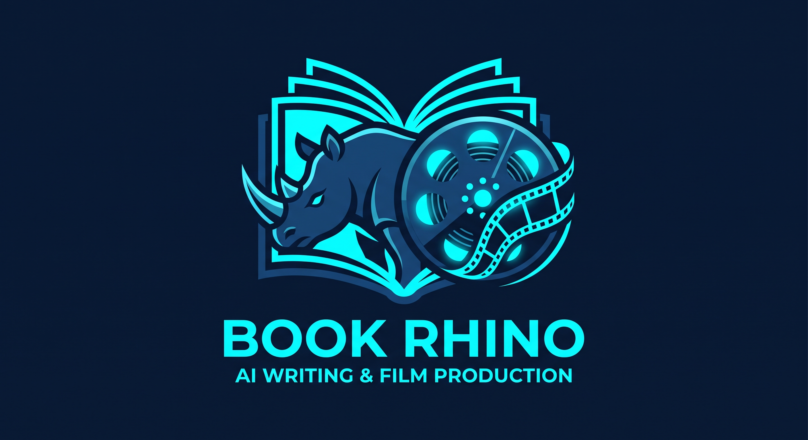

# Book Rhino - AI-Powered Writing & Production Assistant

[](https://www.ruby-lang.org/)
[](https://rubyonrails.org/)
[](https://tailwindcss.com/)
[](https://github.com/leouofa/book-rhino-mcp)
[](docs/openapi.yaml)
[](LICENSE)



Book Rhino is a Rails application engineered to help novelists, screenwriters, and film producers leverage AI to create and publish books and films. It delivers an end-to-end creative suite for structuring narratives, sculpting complex characters, curating visual reference media, and orchestrating asynchronous AI pipelines for prompt synthesis and prose rendering.

---

## Showcase

Completed real-world productions crafted with Book Rhino:

- 📖 **Book**: [*Jealousy in the Jungle: An Invitation for Rivals, An Awakening*](https://www.amazon.com/Jealousy-Jungle-Invitation-Rivals-Awakening/dp/B0DY872FHM) on Amazon
- 🎬 **Film**: [*The Drift*](https://www.youtube.com/watch?v=pmE3Yrr0104) on YouTube | [IMDb Page](https://www.imdb.com/title/tt46763502)

---

## Key Features

### 🤖 REST API v1 & Official MCP Server
Turn Book Rhino into an autonomous agentic writing assistant. Book Rhino ships with a comprehensive REST API v1 (`/api/v1`) covering 17 domain resources, backed by SHA-256 hashed Bearer tokens, asynchronous Sidekiq operation tracking, and a live OpenAPI 3.1 specification.

Pair it with the official **[Book Rhino MCP Server](https://github.com/leouofa/book-rhino-mcp)** to connect Antigravity, Claude Desktop, Claude Code, and Cursor directly to your creative universe. Agents can architect entire novels, generate character profiles, run iterative plot drafts, trigger chapter/scene renders, and export compiled Markdown manuscripts straight to your workspace.

### 🏛️ Architect Your Masterpiece
Structure vast, intricate narratives using proven story frameworks, perspectives, and deeply woven worldbuilding elements:
- **8 Creative Taxonomies**: Perspectives, Character Types, Archetypes, Personality Traits, Moral Alignments, Narrative Structures, Poetic Forms, and Cinematic Styles.
- **Dynamic Style Modeling**: Define custom writing styles with sample prose texts and let the AI extract and enforce consistent tone, cadence, and sentence structure.
- **PaperTrail Versioning**: Full snapshot rollback and AI-assisted merging across books, characters, locations, and writing styles.

### 🎭 Sculpt Multi-Dimensional Characters
Craft characters with psychological depth, evolving backstories, and defining archetypal traits. Use AI-assisted prompt synthesis to generate vivid visual descriptions, wardrobe details, and behavioral quirks, then refine them continuously across multiple versions.

### 📜 Epic Poetry & Poetic Forms
Render chapters and full manuscripts in metered poetic structures. Whether composing epic verse in Dactylic Hexameter, dramatic monologues in Blank Verse, or structured stanzas (Spenserian, Terza Rima, Ballad meter), Book Rhino adapts its prose generation pipeline to honor classical and modern poetic constraints.

### 🎥 Cinematic Styles & Scene Breakdown
Bridge the gap between narrative prose and cinematic video production:
- **Granular Scene Architecture**: Decompose chapters into discrete, playable scenes with character blocking, setting context, and emotional beats.
- **Cinematic Styles**: Attach visual aesthetics, camera movement directions, lighting guidelines, and aspect ratios to guide video prompt generation.
- **One-Click Clipboard Export**: Copy scene content formatted with background prompt instructions for external AI video and image generators (Midjourney, Runway, Luma, Kling, Sora).

### 🖼️ Multi-Asset Visual Reference Management
Maintain visual continuity across productions. Upload and organize reference imagery for characters and locations with multi-image drop zones, inline asset renaming, and direct image serving.

---

## Documentation

- **[Setup Guide](docs/SETUP.md)**: Installation, database configuration, and content blueprint imports.
- **[Development Guide](docs/DEVELOPMENT.md)**: Contribution guidelines, architecture overview, and test suite instructions.
- **[OpenAPI Specification](docs/openapi.yaml)**: Complete API contract for Book Rhino REST API v1 (served live at `/api/v1/openapi.json`).

---

## Quick Start: Connecting via API & MCP

### 1. Generate an API Token

Generate a Bearer token (`br_live_...`) through the Web UI or CLI:

- **Web UI**: Navigate to **API Tokens** (`/api_tokens`) in your running Book Rhino instance.
- **CLI Rake Task**:
  ```bash
  bin/rails "api_tokens:create[you@example.com,MCP Server]"
  ```

### 2. Configure the MCP Server

Add Book Rhino to your MCP client configuration (e.g., Claude Desktop or Antigravity):

```json
{
  "mcpServers": {
    "book-rhino": {
      "command": "npx",
      "args": ["-y", "book-rhino-mcp"],
      "env": {
        "BOOK_RHINO_URL": "http://localhost:3000",
        "BOOK_RHINO_API_KEY": "br_live_your_token_here"
      }
    }
  }
}
```

For advanced configuration and local development of the MCP server, visit the **[book-rhino-mcp repository](https://github.com/leouofa/book-rhino-mcp)**.

---

## License

MIT License. See [LICENSE](LICENSE) for full details.

Copyright (c) 2026 Book Rhino
